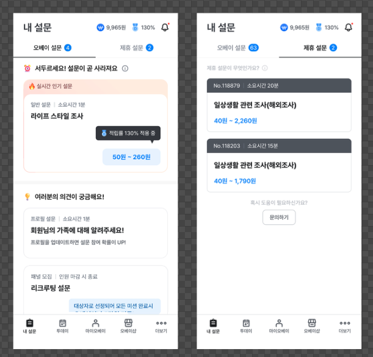

# 오베이 설문과 제휴 설문을 한 목록으로 보여 주세요

[오베이 앱](https://go.ovey.io/)은 ‘내 설문’에서 ‘오베이 설문’과 ‘제휴 설문’을 별도 탭에 보여 줍니다.

오베이 설문은 오베이가 직접 운영합니다. 

제휴 설문은 다른 회사가 운영하는 설문이고, 오베이가 참여할 수 있도록 제공합니다.

**이 과제에서는 두 탭의 설문을 한 목록으로 합쳐 검색, 상태 필터, 정렬, 페이지 조회를 제공한다고 가정합니다.**

이용자 민수는 제목에 “생활”이 들어간 참여 가능한 설문을 최근 수정순으로 봅니다.  
민수가 조회한 뒤, 그 목록에 있던 “일상생활 관련 조사” 제휴 설문 하나가 종료됐습니다. **민수가 다시 조회하면, 종료된 설문은 목록에 남아 있을까요?**

| 조회 방식 | 장점 | 트레이드오프 |
| --- | --- | --- |
| 조회할 때마다 원본에서 설문 데이터를 가져옵니다. | 원본의 변경 사항을 다음 조회에 반영할 수 있습니다. | 목록을 조회할 때마다 원본을 호출해야 합니다. |
| 가져온 설문 데이터를 저장해 두고 사용합니다. | 저장한 데이터로 응답하므로 원본 호출을 줄일 수 있습니다. | 데이터를 갱신하기 전까지 종료된 설문이 참여 가능한 것으로 표시될 수 있습니다. |

**하나의 구조를 구현하고, 그 과정에서 어떤 트레이드오프가 있었는지 설명해 주세요.** 다른 구조도 가능하며, 기술 선택 자체에는 가산점이 없습니다.

## 1. 제공한 원본을 연결해 두 메서드를 구현해 주세요

두 원본은 프로그램 안에서 동작합니다. 실제 앱의 서버에 접속할 필요는 없습니다.

| 원본 | 제공 코드 | 동작 |
| --- | --- | --- |
| 오베이 `OVEY` | [OveySurveySource](src/main/kotlin/com/opensurvey/surveys/OveySurveySource.kt) | 메모리에 있는 설문을 바로 반환합니다. |
| 제휴사 `PARTNER` | [PartnerSurveySource](src/main/kotlin/com/opensurvey/surveys/PartnerSurveySource.kt) | 상황에 따라 응답이 늦어지거나 호출이 실패합니다. |

두 원본은 `SurveySource.fetchAll()`로 전체 설문만 제공합니다. 검색이나 변경 알림은 제공하지 않습니다.
Kotlin 시작 코드 [SurveyRepository.kt](src/main/kotlin/com/opensurvey/surveys/SurveyRepository.kt)에서 다음 두 메서드를 구현해 주세요.

- `getSurveys(request)`는 두 원본의 설문을 검색하고 필터링한 뒤 정렬해 요청한 페이지를 반환합니다.
- 두 원본이 정상 응답할 때, `refresh()`가 완료된 뒤 원본이 다시 바뀌기 전까지는 조회 결과에 원본의 추가, 수정, 삭제가 모두 반영돼야 합니다. 원본을 읽는 시점은 자유입니다.
- 설문을 구분할 때는 `source`와 `id`를 함께 사용합니다. 
  - 예를 들어 제공한 데이터에서 오베이의 `id=1`과 제휴사의 `id=1`은 서로 다른 설문으로 봐야 합니다.

`getSurveys()`는 다음 조건을 적용합니다.

| 조건 | 동작 |
| --- | --- |
| 검색 `query` | 제목에 검색어가 포함된 설문을 찾습니다. |
| 상태 `status` | 요청의 `status`가 `OPEN`이면 참여 가능한 설문만, `CLOSED`면 종료된 설문만, `null`이면 전체를 대상으로 합니다. |
| 페이지 | 정렬한 결과에서 `page`번째 페이지의 `size`개를 반환합니다. 첫 페이지는 0입니다. |

정렬은 `request.sort`로 선택합니다.

| 정렬 | 비교 순서 |
| --- | --- |
| 최근 수정순 `UPDATED_DESC` — 기본값 | `updatedAt`이 최근인 설문부터 반환합니다. |
| 보상 높은 순 `REWARD_DESC` | `rewardMin`, `rewardMax`로 주어진 보상 구간을 어떤 값으로 비교할지는 직접 정해 주세요. |
| 소요시간 짧은 순 `DURATION_ASC` | `estimatedMinutes`가 작은 순서입니다. |

같은 값일 때의 순서도 직접 정해 주세요. 같은 조건으로 다시 조회하거나 페이지를 넘겨도 순서는 일정해야 합니다.

## 2. 세 상황을 실행하고 선택한 구조의 한계를 확인해 주세요

터미널에서 이 README와 `gradlew`가 있는 과제 폴더로 이동한 뒤, JDK 25로 아래 명령을 실행해 주세요.
IDE에서는 Gradle JVM을 JDK 25로, Gradle 버전은 프로젝트의 Wrapper를 사용하도록 설정해 주세요.
Windows에서는 아래 명령의 `./gradlew`를 `.\gradlew.bat`로 바꿔 주세요.
처음 실행할 때는 Gradle과 라이브러리를 내려받을 수 있는 인터넷 연결이 필요합니다.
공개 테스트(`PublicCasesTest`)는 `./gradlew test`로 실행합니다. 구현하기 전에 실행하면 예제는 구현할 위치를 안내하고, 공개 테스트는 실패합니다.

| 상황 | 실행 명령 | 확인할 것 |
| --- | --- | --- |
| 원본 변경 | `./gradlew run --args=fast` | 원본의 설문이 바뀐 뒤 구현한 조회에는 언제 반영되나요? 각 정렬 방식에 따라 설문은 어떤 순서로 반환되나요? |
| 느린 제휴사 | `./gradlew run --args=slow` | 제휴사 원본이 500ms 늦어지면 어느 호출이 기다리나요? |
| 제휴사 오류 | `./gradlew run --args=failure` | 제휴사 원본의 `fetchAll()` 두 번째 호출이 실패하면 구현한 `getSurveys()`는 어떤 결과를 반환하나요? |

예제는 반환한 설문, 원본 호출 횟수, 실행 시간, 오류를 보여 줍니다.
원본 호출 횟수(`fetchCount`)에는 생성자와 `refresh()`에서 읽은 횟수도 포함합니다.
**세 상황을 실행하고 본인이 선택한 구조의 한계를 [solution.md](solution.md)에 기록해 주세요.**

예제에서 원본이 바뀌는 방식

`Main`에서 만든 두 원본은 각각 다음 순서로 데이터를 한 번만 바꿉니다.

1. 각 원본의 `fetchAll()`이 처음 성공하면 초기 목록을 반환합니다.
2. 같은 호출에서 원본은 내부 데이터를 바꿉니다. 오베이 원본에는 `id=4`인 “여가생활 조사”가 추가됩니다. 제휴사 원본에서 `id=1`인 설문은 상태가 `OPEN`에서 `CLOSED`로 바뀌고 수정 시각도 바뀝니다. 이때 반환한 초기 목록은 그대로 유지됩니다.
3. 이후 `fetchAll()`이 성공하면 해당 원본은 변경된 목록을 반환합니다. 호출을 반복해도 원본은 데이터를 더 바꾸지 않습니다.

`SurveyRepository`가 이전에 읽은 목록을 보관한다면, 원본 데이터가 바뀌어도 조회 결과는 그대로일 수 있습니다. `SurveyRepository`가 원본을 다시 읽어야 변경된 설문을 조회에 반영할 수 있습니다.

실패한 `fetchAll()` 호출은 원본 데이터를 바꾸지 않지만, `fetchCount`에는 포함됩니다.

테스트에서 초기 목록을 생성자에 직접 전달하면 원본은 자동으로 바뀌지 않습니다. 이 경우에는 `replaceSurveys(...)`를 호출하면 원본 데이터가 바뀝니다.

